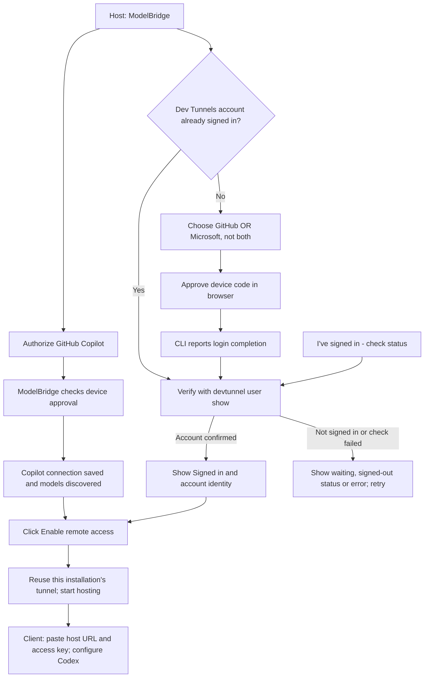

# ModelBridge

One desktop application for hosting a Copilot subscription and connecting
Codex to local or remote models. Host and client are roles within the same
installation, not separate Gateway and Connector products.
The new desktop structure retains the original Copilot API's direct
authentication, token exchange, forwarding and protocol translations.
**There is no Copilot SDK integration.**

**Development pre-release: 0.1.0-dev.4.**

Download the unsigned Windows installer from the
[ModelBridge development release](https://github.com/rajathnaik/Copilot-API/releases/tag/modelbridge-v0.1.0-dev.4):

- [Windows installer](https://github.com/rajathnaik/Copilot-API/releases/download/modelbridge-v0.1.0-dev.4/ModelBridge.Setup.0.1.0-dev.4.exe)
- [SHA256 checksum](https://github.com/rajathnaik/Copilot-API/releases/download/modelbridge-v0.1.0-dev.4/ModelBridge.Setup.0.1.0-dev.4.exe.sha256)

Compare `Get-FileHash .\ModelBridge.Setup.0.1.0-dev.4.exe -Algorithm SHA256`
with the downloaded checksum before running the installer. Windows may warn
about an unknown publisher because this development build is not code-signed.
Use the same installer on the host and client machines.

To build the unsigned Windows development installer locally, run
`bun run --cwd apps/modelbridge package:win`. Its output is
`apps/modelbridge/release/ModelBridge.Setup.0.1.0-dev.4.exe`. This is a test
candidate, not a verified production release; installation/upgrade/uninstall
and the real two-machine acceptance test are still pending.

## Current implementation

- One Electron desktop application with its own Windows identity:
  `com.rajathnaik.modelbridge`.
- A local, authenticated gateway on `127.0.0.1:4321`.
- GitHub device-code sign-in for Copilot, subscription model discovery,
  short-lived Copilot token refresh, and forwarding to the account's service
  endpoint. Native Responses models and the inherited Messages/Chat
  Completions translators expose a Responses interface for Codex.
- API-source discovery and native Responses, Messages, and Chat Completions
  forwarding. Select the protocol the provider actually supports.
- Remote ModelBridge sources, source-qualified model IDs, and explicit
  routing. No silent fallback to another source, account, or paid API.
- An authenticated Codex-native catalog at `/v1/codex/models`, separate from
  OpenAI-style `/v1/models`. It exposes Responses models only, includes the
  required model instructions, preserves explicit tool/context capabilities
  across remote hops, supports ETag refresh, and enforces Codex's 1 MiB limit.
- Independently selected sources for sharing through a separate authenticated
  listener on `127.0.0.1:4322`.
- Credentials (access keys and the Copilot sign-in token) are stored
  **unencrypted** in `%APPDATA%\ModelBridge\credentials.json`, protected only
  by your Windows user account. This is a deliberate simplification for a
  personal tool; at-rest encryption is deferred. Codex obtains its local key by
  running the same installed ModelBridge executable in credential-only mode,
  so the key is still never written into Codex's TOML.
  There is no automatic import of old product settings. A profile encrypted by
  0.1.0-dev.0/dev.1 is archived to a `legacy-encrypted-*` folder on first start;
  the tunnel ID (and therefore the URL) is kept, but you must sign in to Copilot
  again and re-apply the Codex configuration.
- The window opens immediately and shows a startup state while the runtime
  starts. Sections are split into Overview, Host, Connect, Sources & models and
  Codex tabs.
- Codex installation discovery, redacted configuration previews, named
  revisions, reactivation, native configuration restoration, external-edit
  detection and recovery of interrupted configuration writes.
- Microsoft Dev Tunnels provisioning and hosting with a persistent,
  installation-specific tunnel ID.
- Tray operation: closing the window keeps the local runtime available.
- English-only application and packaged Electron resources.

## Windows installation prerequisites

The installer asks how you intend to use this machine:

- **Use as a host:** a working Microsoft Dev Tunnels CLI is required before
  installation can proceed. Open the linked Microsoft installation instructions,
  install the CLI yourself (for example, `winget install Microsoft.devtunnel`),
  then click **Recheck** without closing the wizard.
- **Client-only for now:** no Dev Tunnels CLI is required. Add the remote host
  URL and access key in ModelBridge. You can install the CLI later if this
  machine should also host.

This choice checks prerequisites; it does not permanently restrict the app's
role. The installer validates the CLI offline using `--help`, not a sign-in or
live tunnel. Detection includes PATH, updated user/system registry PATH and
the standard user/machine WinGet links/package locations. No global PATH is
modified, no CLI is downloaded/bundled/upgraded, and Microsoft's terms must be
accepted separately. The CLI is proprietary software, not covered by the
MIT license of Microsoft's tunnel SDK.

Unattended installation (`/S`) defaults to client-only. Use `/S /HOST` to require
the host prerequisite; a missing/invalid CLI exits with code **2** before
installing ModelBridge. Successful CLI detection does not replace Microsoft
sign-in or verify subscription/tunnel connectivity.

Electron and its Node runtime are bundled. Bun is only a development/build
prerequisite. The app uses Windows PowerShell only asynchronously, to refresh
PATH when looking for the Dev Tunnels and Codex CLIs.

When you click **Install**, the installer checks whether ModelBridge is
already running using an in-process lookup (`nsProcess`). The stock
electron-builder check shells out to PowerShell/WMI without a timeout and could
hang indefinitely on machines where PowerShell or WMI is slow or held by
security software; ModelBridge overrides it in both the installer and
uninstaller.

Source discovery is not inference verification. Generic API and remote
sources forward their advertised protocol; Copilot has its own inherited
cross-protocol adapters. Some provider APIs require dedicated discovery
adapters or pagination; the generic source integration does not claim support
for every provider.

## Troubleshooting installation

The installer cannot write a log file: electron-builder ships NSIS without
logging support. If the wizard freezes, note the last page shown and check
Task Manager for a `ModelBridge.Setup…` process at constant CPU (a script loop)
versus child processes such as `powershell.exe` or `devtunnel.exe` (a waiting
external command). Builds before 0.1.0-dev.3 froze on entering the
prerequisite page when the user PATH did not end with `;`.

## Troubleshooting startup

ModelBridge writes a non-secret diagnostics log to
`%APPDATA%\ModelBridge\logs\modelbridge.log` (rotated at 512 KB). It records
startup timings, window responsiveness and renderer/child-process failures; it
never records keys or tokens. If the window stays on "Starting ModelBridge…" or
startup fails, check this file first. ModelBridge is single-instance: launching
it again focuses the running window, including one hidden in the tray.

## Pending live verification and subsequent work

Real Copilot subscription inference through a live Dev Tunnel on two machines
has not yet been verified. Automated tests use synthetic providers and
isolated profiles, not a real subscription. Claude Code/OpenCode/Hermes/OpenClaw
discovery and setup, other subscription providers, account-specific allowances,
per-consumer remote keys, key rotation controls, and release/update automation
remain subsequent implementation milestones. Claude subscription integration
requires a separate feasibility and permitted-use assessment.

The development installer has been built and its unpacked executable has been
smoke-tested outside the workspace, including helper key retrieval while
the app runs, authenticated inference and packaged attribution. The prerequisite wizard has been tested with isolated missing/invalid/working
CLI fixtures and the full installer has been opened and cancelled before
installation, including detection of this host's installed CLI. An isolated variant of the
installer (different app ID/product name) has been silently installed,
reinstalled over a running app, and uninstalled without starting PowerShell;
upgrading a real dev.0/dev.1 installation still runs that build's old
uninstaller, which uses the stock PowerShell check. Existing
installations and historical Git/releases have not been removed. Codex
configuration is modified only after approving an explicit preview.

## What changes in Codex

On the client, add the host URL and host access key in ModelBridge. It discovers
the host's shared models and exposes them through its own local gateway.
Discover the installed Codex, choose a model and configuration name, and use
**Preview exact Codex changes** before applying.

ModelBridge edits the user-level `CODEX_HOME\config.toml` (normally
`%USERPROFILE%\.codex\config.toml`):

- `model_provider = "modelbridge"` selects the custom provider.
- `model` selects an exact source-qualified route, not a ChatGPT model alias.
- `[model_providers.modelbridge]` points `base_url` to the local `/v1` gateway,
  uses `wire_api = "responses"`, disables OpenAI authentication and websockets,
  and identifies the authenticated native model catalog URL.
- `model_catalog_json` points to a model-metadata snapshot, allowing Codex's
  picker to discover these models at startup.
- The provider's `auth.command` runs ModelBridge in credential-only mode with
  the explicit ModelBridge profile path. Its stdout is the local key, not a
  JSON envelope. Neither the host key nor Copilot token is stored in Codex.
- Reasoning/context settings are adjusted to the selected model's advertised
  capabilities. Unrelated TOML settings/comments are preserved.

The preview shows the current and proposed TOML with secrets redacted.
Revisions and the original managed settings are stored in ModelBridge's
profile. Restore native settings returns the owned fields/provider to their
original values while preserving later unrelated edits. External changes to
managed fields require explicit acknowledgement instead of being overwritten.
The app does not edit Codex's `auth.json`, sign you out, or add entitlement to
your ChatGPT subscription. Project/profile/CLI/managed settings can override
user-level configuration; restart Codex and start a new local chat after
switching because existing threads can retain their provider.

## How remote URLs work

ModelBridge does not invent a public hostname. On explicit **Enable remote
access**, it asks the Microsoft Dev Tunnels CLI to create or reuse its owned
persistent tunnel, registers the sharing port, and starts a host process.
Microsoft assigns the HTTPS URL; ModelBridge reads it from returned metadata.
The URL is reusable while the tunnel identity and port remain valid, but it is
not guaranteed permanent if the service resource expires or is recreated.

The relay permits anonymous transport access so a consumer only needs the host
URL and **ModelBridge host access key**. That does not mean the API is
unauthenticated. Local-client and remote-host keys are separate, and the
remote listener exposes only sources explicitly selected for sharing.

The host needs Microsoft's separately installed CLI and a one-time Dev Tunnels
sign-in. Dev Tunnels accepts a **GitHub account** (for example, the one you use
for Copilot; `devtunnel user login -g -d`) or a **Microsoft account**
(`devtunnel user login -d`). ModelBridge shows the account the CLI is already
signed in with (`devtunnel user show`), so you only sign in again to switch
accounts or after the CLI's sign-in expires. This sign-in only lets the host
own the tunnel; it is separate from the Copilot sign-in, and clients never sign
in to Dev Tunnels.

The host shows **Waiting for approval...**, **Checking sign-in...**, then a
disabled **Signed in** button with the account name and provider. The CLI
reports device-login completion; ModelBridge then runs `devtunnel user show`
to verify it. No browser callback URL is required. The UI refreshes every two
seconds. **I've signed in - check status** (or **Check sign-in status**) repeats
that verification manually, including after signing in outside the app. It
does not assume success from the button click. A failed check displays the
error rather than claiming the account is signed out or signed in. Signing in
does not start sharing: **Enable remote access** remains a separate action.
Copilot also uses device authorization: ModelBridge polls for approval and
confirms **Signed in** after saving the connection and discovering models.



The same GitHub account can perform both authorizations, but they grant access
to different services and use separate credentials. A Microsoft account is
optional, not an additional requirement. Signing in to Dev Tunnels alone does
not grant access to Copilot or confirm that sharing is running.

The installer's host prerequisite page checks the CLI and links to manual
installation instructions; ModelBridge offers device-code sign-in but does not
install software automatically. The client does not need this CLI. Both the
ModelBridge runtime and tunnel-host process must remain running.
[Microsoft's CLI reference](https://learn.microsoft.com/azure/developer/dev-tunnels/cli-commands)
describes provisioning, access controls, and service limitations. Dev Tunnels
is a preview service without a production SLA.

## Development

Requires Bun 1.4.2 and Node 22.18+; Windows is the first validated desktop
platform. Electron is pinned to 43.4.1.

```sh
bun install --frozen-lockfile
bun run dev
bun run build
bun run lint:all
bun run typecheck:all
bun run test
```

`MODELBRIDGE_PORT` overrides the local port; `0` selects an ephemeral port for
tests. Sharing uses port 4322. The desktop defaults to
`%APPDATA%\ModelBridge`; `--user-data-dir` explicitly selects an isolated
profile. `credentials.json` holds keys in plain text; do not share or commit it.

Missing or corrupt profile metadata/credentials are explicit failures, not
permission to silently regenerate keys. Preserve the affected profile for
recovery, or choose a fresh isolated profile for a new setup.
Interactive profile recovery is a later milestone.

The Windows native restart test uses a temporary Electron application/profile
and a synthetic provider. After building, run it from PowerShell:

```powershell
node .\scripts\ensure-electron.mjs
if ($LASTEXITCODE -ne 0) { throw 'Electron binary initialization failed.' }
$env:MODELBRIDGE_TEST_ELECTRON = node -p "require('electron')"
Set-Location apps\modelbridge
bun test .\tests\native-profile.test.ts
```

It verifies authenticated inference, credential storage, the actual
credential-only executable mode and stable local-key hashes across two
graceful application launches. It never provisions live
tunnels or modifies existing user profiles.
With `MODELBRIDGE_TEST_CODEX` also set, it clicks the real desktop's discovery,
preview, apply and restore controls, exercises revision reactivation, and
checks that the synthetic native account remains unchanged. Applying also
checks the helper while the app is still running, including a fresh profile.

To repeat the packaged-runtime test, set `MODELBRIDGE_TEST_PACKAGED_EXE` to the
build's `release\win-unpacked\ModelBridge.exe` and run
`bun test .\apps\modelbridge\tests\packaged-profile.test.ts` from the repository
root. It uses synthetic credentials and temporary ModelBridge/Codex profiles;
it does not install the app or modify existing user profiles.

The installer prerequisite tests are also opt-in. After packaging, point
`MODELBRIDGE_TEST_NSIS` at the cached NSIS `makensis.exe` and
`MODELBRIDGE_TEST_INSTALLER_EXE` at the built installer, then run
`bun test .\apps\modelbridge\tests\installer-prerequisites.test.ts`.
The native harness checks missing/invalid/working CLI handling, host/client
gating, recheck, cancellation and unattended exit codes using temporary
fixtures. The full wizard test opens the actual installer and cancels before
installation; it never clicks Install. Set `MODELBRIDGE_TEST_EXPECT_CLI=1`
on a known-ready host to require successful real CLI detection too.
This does not prove actual installation, upgrade or uninstall.

### Codex compatibility proof

Validated against the installed Windows desktop package **26.1002.7124.0**
and its bundled **codex-cli 0.162.0-alpha.2**:

- Actual app-server `model/list` discovers the source-qualified catalog.
- Complete Responses streams route two distinct models through an authenticated
  synthetic Copilot service -> sharing gateway -> consumer gateway -> Codex.
  The repeatable backend test covers native Responses plus inherited
  Messages and Chat Completions adapters.
- Codex executes an offered, harmless `exec_command` on the consumer and returns
  its matching `function_call_output`; the provider then completes the reply.
- Separate native desktop inspection confirmed that its picker displays both
  models as enabled options, and
  selecting the second updates its active model label.
- A synthetic native-account fixture remains byte-for-byte unchanged. These
  tests never read, copy, or edit a real account or harness profile.
- The backend/tool test uses the actual managed TOML/catalog and command-auth
  contract, then restores the synthetic native configuration.

The repeatable opt-in backend/tool test requires a separately installed Codex
console CLI.

```powershell
$env:MODELBRIDGE_TEST_CODEX = 'C:\path\to\installed\resources\codex.exe'
bun test .\apps\modelbridge\tests\codex-compatibility.test.ts
```

The separate desktop inspection used an isolated `CODEX_HOME`, isolated
Electron user data, a loopback debugging endpoint, and synthetic credentials;
it did not submit a paid request. Native GUI automation is not yet a repeatable
regression check: this desktop build can launch different first-run onboarding
flows before reaching Codex. Its GUI executable is selected from the package
manifest, not inferred from a file named `Codex.exe`.
This proves compatibility for that version, not universal desktop support,
real subscription hosting or native sign-in preservation with a real account.
Those remain live smoke-test milestones. The native desktop's cloud-only features may still require its
original ChatGPT sign-in independently of a custom local provider.

## Source boundaries

| Location | Responsibility |
| --- | --- |
| [apps/modelbridge](apps/modelbridge/) | Desktop lifecycle, IPC, UI, profile composition, tray and CLI process management |
| [packages/runtime](packages/runtime/) | Validated source contracts, explicit routing, gateway authentication, streaming, credential storage abstraction and tunnel provisioning |
| [tests](tests/) | Product identity and architectural boundaries |
| [scripts](scripts/) | Electron bootstrap, lint conventions and ModelBridge icon generation |

The desktop bundles runtime and renderer dependencies at build time. Packaged
execution does not depend on workspace symlinks or TypeScript source files.

The inherited application shells, CLI, plugins, Docker setup, old guides and
legacy release workflows have been retired from the active source tree. They
remain available in Git history. No remote release assets or tags are deleted.
ModelBridge releases use `modelbridge-v<version>` and require explicit
approval of the product/version after validation.

[MIT license](LICENSE) · [Lineage and responsible use](NOTICE.md)
